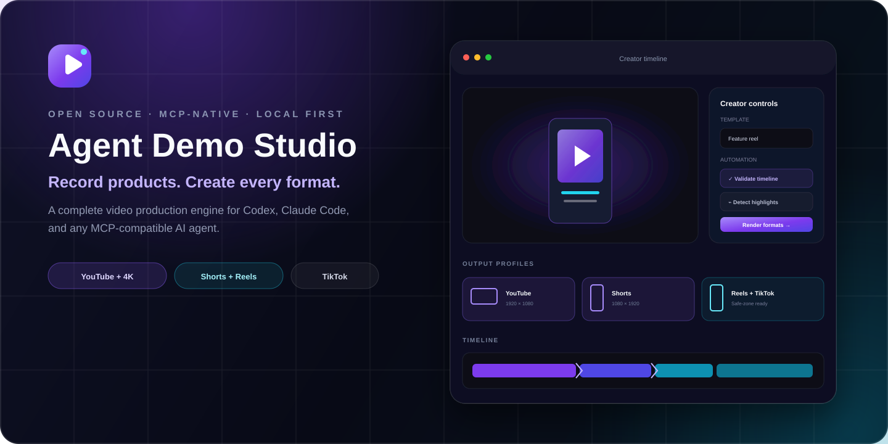
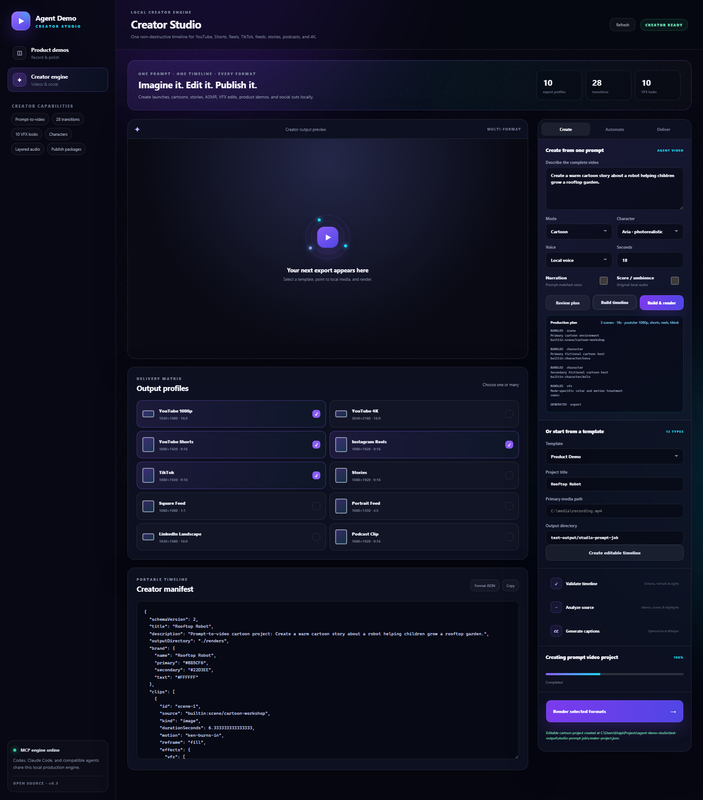
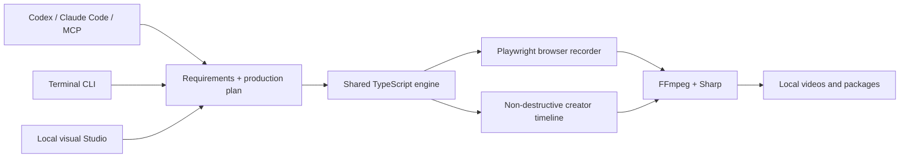

<p align="center">
  
</p>

<p align="center">
  <a href="https://github.com/khajaaijaz26/agent-demo-studio/actions/workflows/ci.yml"></a>
  <a href="LICENSE"></a>
  <a href="package.json"></a>
  <a href="https://github.com/khajaaijaz26/agent-demo-studio/releases"></a>
</p>

<p align="center">
  <strong>Let Codex, Claude Code, or any MCP client plan first, record a real browser, and create polished product launches, demos, cartoons, stories, ASMR videos, VFX edits, YouTube videos, Shorts, Reels, and TikToks—all locally.</strong>
</p>

Agent Demo Studio is an open-source MCP server, CLI, browser recorder, plan-first video builder, FFmpeg editing/VFX engine, and visual Studio. The same non-destructive project can produce landscape, vertical, square, portrait, and 4K exports with synchronized audio, captions, animation, fictional presenters and characters, transitions, overlays, thumbnails, chapters, rights reports, and reviewed publishing packages.

<p align="center">
  
</p>

## What it can do

| Stage | Included capabilities |
|---|---|
| Record | Visible or headless Chromium, semantic click/fill/scroll/press/hover actions, live snapshots, chapters, click highlights, smooth cursor, scripted or adaptive agent control |
| Edit | Ordered clips, trims, image clips, constant speed, audio-synchronized stepped speed ramps, freeze frames, volume/mute, fit/fill/blur-background reframing, focus point, color/effect controls |
| Plan | Optional one-call local Qwen intelligence plus an instant fallback, requirements, audience, creative direction, timed storyboard, resource/provenance list, fixed production rules, workflow, and QA gates before media creation |
| Transition | 28 cut, fade, dissolve, wipe, slide, smooth, shape, zoom, squeeze, diagonal, blur, and reveal options—with matching audio crossfades |
| Design | Brand palette, logo, text, lower thirds, calls to action, speech bubbles, image/video layers, chroma key, fictional presenters/cartoon characters, safe zones, and thumbnails |
| Animate/VFX | True 1080p vector scene animation with articulated characters, blinking, gestures, mouth motion, moving props and particles; optional LTX Desktop, ComfyUI/Wan, and loopback generation adapters; 10 composable cinematic/VFX looks |
| Audio | Clip audio, multiple voices, music, ambience, SFX, pan, looping, trims, delays, fades, gain, automatic ducking, 48 kHz stereo, loudness normalization, and limiting |
| Captions | SRT and WebVTT import, optional local Whisper transcription, scalable ASS burn-in, editable SRT sidecar, per-format safe zones |
| Automate | Request-aware local capability discovery, five prompt-video modes, silence/scene detection, suggested highlights, 13 editable templates, manifest validation, resource discovery, and background jobs |
| Export | YouTube 1080p/4K, Shorts, Reels, TikTok, Stories, square, portrait, LinkedIn, and podcast-vertical presets |
| Deliver | MP4, thumbnail, captions, chapters, metadata, profile checks, asset-rights report, self-contained publishing package, explicit credentialed publishing adapters |

Everything runs on the creator's machine. No Agent Demo Studio account or hosted project storage is required.

## Quick start

Requirements: Node.js 20.12 or newer, FFmpeg/FFprobe on `PATH`, and Codex or Claude Code if you want agent control. Ollama with Qwen is optional; prompt creation still works without it.

```bash
npm install --global github:khajaaijaz26/agent-demo-studio
agent-demo setup
agent-demo doctor
agent-demo capabilities
```

`agent-demo setup` installs Playwright Chromium when needed and registers the local MCP server with detected Codex and Claude Code installations. For another MCP client, run `agent-demo mcp-config` and use the printed configuration.

`agent-demo capabilities` checks the exact standard production path before a job
starts. It reports planners, recording, visuals, voices, captions, music, FFmpeg,
and agent integrations as ready, configured, or unavailable, identifies selected
blockers, and never sends media or secrets to a provider.

Create a browser demo immediately:

```bash
agent-demo quick https://example.com --title "A faster product tour"
```

Or open the all-in-one local Studio:

```bash
agent-demo studio
```

The Studio binds to `127.0.0.1` and opens in the default browser. Its primary
surface is a simple chat: describe the video, attach authorized media, choose a
format if needed, and receive the saved plan, live progress, preview, download,
captions, thumbnail, chapters, and rights artifacts in the same conversation.

Prefer to stay in the terminal? The free interactive dashboard exposes the same
plan, build/render, local media paths, characters, voices, formats, Qwen warmup, and
standalone music creation flow:

```bash
agent-demo dashboard
```

See the [terminal dashboard and another-laptop setup](docs/TERMINAL-DASHBOARD.md).

For the fastest zero-token local planning, install the small Qwen model once and
keep it warm:

```bash
ollama pull qwen3.5:0.8b
agent-demo creator local-ai --warm --profile fast
```

The planner makes at most one bounded local model call per video and falls back
to instant deterministic planning instead of blocking. Use
`--planner-profile quality` to prefer an installed `qwen3.5:4b`, or
`--planner deterministic` for no inference. Ollama endpoints are loopback-only
and cloud-tagged models are rejected. See [local AI, uploads, generation adapters,
and voice profiles](docs/LOCAL-AI.md).

## Honest video-engine routing

Agent Demo Studio never labels a moving photograph or a reusable canvas loop as
generated character video. CLI/MCP `auto` routing interprets the requested
quality first: requests for a film, cartoon, advertisement, Reel, or realistic
motion require a configured model-video backend; if it is unavailable, the saved
plan reports the blocker instead of faking the result. The visual Studio opens
with **Local animation** visibly selected so an ordinary laptop can render
immediately; choose **Generative AI video** explicitly when a model backend is
connected. Every generated clip must pass a temporal-motion probe before it
enters the timeline, and loopback backends must return a unique, scene-addressed
video for every storyboard beat.

| Engine | Best for | Readiness rule |
|---|---|---|
| Built-in animation | Fast cartoons, education, stories, product motion, ASMR, and VFX on ordinary laptops | Local Playwright Chromium + FFmpeg; no checkpoint or API tokens |
| LTX Desktop | Text/image/audio-to-video on supported hardware | Official loopback backend must be healthy; paid API-only mode is rejected unless explicitly enabled |
| ComfyUI | LTX, Wan, AnimateDiff, and custom API workflows | Loopback server plus an exported API workflow containing `{{PROMPT}}` |
| Wan-Animate-2 | Reference-character motion driven by a video | Model weights plus a loopback adapter on suitable NVIDIA multi-GPU hardware; a metadata-only clone is reported as not runnable |
| Custom adapter | Any local generator implementing the v2 scene-batch contract | Loopback endpoint; real-video tasks must return one moving video per scene |
| Legacy still compositor | Slides and intentionally locked artwork | Explicit selection only; never auto-selected as animation |

LTX and Wan are optional. Qwen plans text; it does not generate frames. On a
machine without a compatible generative-video GPU, the built-in engine still
creates actual changing frames with independently animated subjects and stable
backgrounds instead of camera shake or fake photo motion. Select that honest
fallback with `--visual-quality motion-graphics`; it is not represented as a
Wan/LTX-quality foundation-model render.

## Universal prompts, open characters, and voices

The five named treatments control editing, pacing, music, captions, and VFX; they
do not define an allowed subject list. `--mode auto` (the default) can plan an
educational diagram, anime scene, documentary, fictional creature, product film,
music video, scientific visualization, or another brief without discarding the
original prompt. Model-backed routes receive the complete scene prompts,
negative prompt, deterministic seed, language, scene audio, export targets, and
every authorized character and scene reference.

The provider-neutral loopback contract is deliberately open: a local Wan,
ComfyUI, LTX, or future engine can implement text-to-video, image-to-video,
speech-to-video, or character animation without adding the character or style to
this repository. Voice names are also open strings supported by the selected
system/neural engine; narration and captions accept a BCP-47 language such as
`en-US`, `ar-AE`, or `hi-IN`, and consented voice references remain available
through the local clone adapter.

“Universal” here means the orchestrator does not impose a closed cast, style, or
topic vocabulary. Actual visual fidelity still depends on the connected model
and its hardware; the lightweight motion-graphics fallback cannot truthfully
invent every possible person, creature, object, or art style like Wan or LTX.

## Give the work to an AI agent

After setup, this is enough for Codex or Claude Code:

```text
Plan and create a complete product demo for https://my-product.example.
First inspect the installed local capabilities. Then write the requirements,
visual direction, timed storyboard, resource list,
assumptions, and QA checklist. Then use a visible browser, show sign-in and the
main workflow, add chapters, and build the video scene by scene. Render a 1080p
master plus Shorts, Reels, and TikTok variants with natural narration, readable
captions, and quiet music. Return the plan and local output files. Do not publish.
```

For an adaptive recording, the agent can inspect each browser snapshot and decide the next semantic action. For a known flow, it can submit the complete action list in one job. Prompt-video jobs always persist `production-plan.json`, including the request-aware capability inventory, before creating audio, a timeline, or renders. If a selected required tool is missing, the saved plan explains the blocker and production stops before media generation. Media remains outside model context; MCP returns local file resources.

## Create from a prompt—plan first

Review the interpreted requirements, look, scenes, resources, workflow, assumptions, and quality gates without rendering anything:

```bash
agent-demo creator plan \
  "Launch a privacy-first AI lesson planner for busy teachers" \
  --mode product-launch --duration 45
```

Then create the editable project and its videos:

```bash
agent-demo creator prompt \
  "Launch a privacy-first AI lesson planner for busy teachers" \
  --mode auto --visual-quality motion-graphics --presenter aria \
  --presets youtube-1080p,shorts,reels --render
```

`--mode auto` is the default and resolves to the most suitable editing treatment;
explicit treatments are `product-launch`, `cartoon`, `story`, `asmr`, and `vfx`.
Every job writes the plan first, resolves a rights-aware resource list, generates
enabled audio/captions, builds the schema-v2 timeline, and only then renders.
Bundled fictional presenters Aria and Leo, original cartoon hosts Nova and Milo,
and four original scene environments provide an offline starting point. See the
[plan-first prompt-video guide](docs/PROMPT-VIDEO-AND-VFX.md) and [asset provenance](assets/README.md).

Those bundled characters are optional starters, not a fixed cast. The Studio and
CLI accept any number of authorized scene images/videos and character images,
plus a logo, music, and a consented local voice reference. Uploaded stills become
true image-to-video inputs when LTX, ComfyUI, or a loopback video adapter is
selected. If the user explicitly chooses the legacy compositor, artwork stays
locked and is never shaken or panned to imitate generated motion. The documented
adapter supports text-to-image, image-to-video, text-to-video, speech-to-video,
and character-animation engines without coupling the renderer to one model.

Repository-native Codex and Claude Code instructions in [AGENTS.md](AGENTS.md) and
[CLAUDE.md](CLAUDE.md) enforce the same plan-first contract when an agent works from
a source checkout.

## Turn any recording into social variants

The fastest creator workflow needs only one source video:

```bash
agent-demo creator remix ./recording.mp4 \
  --presets youtube-1080p,shorts,reels,tiktok,square \
  --captions ./captions.srt \
  --music ./music.mp3 \
  --title "Launch day"
```

For a reusable timeline, start from one of the 13 templates:

```bash
agent-demo creator templates
agent-demo creator init product-demo --source ./recording.mp4 --title "Product tour"
agent-demo creator validate creator-project.json
agent-demo creator render creator-project.json
```

Templates include `product-demo`, `product-launch`, `feature-reel`, `launch-short`, `cartoon-story`, `narrated-story`, `asmr`, `vfx-showcase`, `tutorial`, `talking-head`, `podcast-clip`, `testimonial`, and `before-after`.

The manifest stays editable JSON. A single project can hold clip timing, effects, captions, voice, music, brand design, licensing, metadata, and many export targets. See the [complete example](examples/creator-project.json) and [manifest reference](docs/CREATOR-MANIFEST.md).

```json
{
  "schemaVersion": 2,
  "title": "Feature launch",
  "clips": [
    {
      "id": "dashboard",
      "source": "./media/dashboard.mp4",
      "trimStartSeconds": 1.2,
      "trimEndSeconds": 8.4,
      "speedRamp": { "from": 1, "to": 1.6, "steps": 8 },
      "reframe": "blur-background",
      "transition": { "type": "slide-left", "durationSeconds": 0.35 }
    }
  ],
  "captions": { "source": "./captions.srt", "burn": true, "sidecar": true },
  "audio": {
    "music": { "source": "./music.mp3", "volume": 0.12, "loop": true },
    "duckMusic": true,
    "targetLufs": -14
  },
  "exports": [
    { "id": "youtube", "preset": "youtube-1080p" },
    { "id": "short", "preset": "shorts" },
    { "id": "reel", "preset": "reels" }
  ]
}
```

## Export profiles

| Preset | Canvas | Typical use |
|---|---:|---|
| `youtube-1080p` | 1920×1080 | Product demos, tutorials, courses |
| `youtube-4k` | 3840×2160 | High-detail masters |
| `shorts` | 1080×1920 | YouTube Shorts |
| `reels` | 1080×1920 | Instagram Reels |
| `tiktok` | 1080×1920 | TikTok posts |
| `story` | 1080×1920 | Mobile Stories |
| `square` | 1080×1080 | Cross-platform feed video |
| `portrait` | 1080×1350 | 4:5 feed video |
| `linkedin` | 1920×1080 | Professional product stories |
| `podcast-vertical` | 1080×1920 | Caption-led podcast excerpts |

Profiles define frame rate, bitrate, safe zones, and advisory limits. Rendered files are probed and validated against the selected profile. TikTok duration is checked against the authenticated creator's current API value during publishing rather than a stale hard-coded limit. See [platform profiles](docs/PLATFORM-PROFILES.md).

## Local analysis and captions

Detect silence, scene changes, and candidate highlights:

```bash
agent-demo creator analyze ./long-recording.mp4 --out analysis.json
```

Optional local transcription uses an installed Whisper CLI:

```bash
agent-demo creator transcribe ./long-recording.mp4 --model turbo --format srt
```

For scene-synchronized neural narration, install `edge-tts`, describe each recorded scene and voice in a synchronized manifest, then run `agent-demo sync tour.json`. Narration is generated scene by scene at a natural rate; the related visual timing is adjusted to match. Each configured voice receives its own master and optional SRT sidecar.

## Three control surfaces, one engine



- **MCP** gives agents structured planning, resource discovery, recording, editing, analysis, rendering, packaging, and publishing tools.
- **CLI** makes every workflow scriptable in a terminal or CI environment.
- **Studio** provides a chat-first create flow, resource uploads, project browsing, engine truth/readiness, character/voice/music controls, background plan/render progress, in-chat preview, and artifact downloads; advanced controls remain in the sidebar.

The architectural boundaries and render stages are documented in [docs/ARCHITECTURE.md](docs/ARCHITECTURE.md).

## MCP tools

| Group | Tools |
|---|---|
| Projects | `demo_create_project`, `demo_get_project`, `demo_list_projects` |
| Live browser | `demo_browser_start`, `demo_browser_snapshot`, `demo_browser_act`, `demo_browser_finish` |
| Product demos | `demo_record_flow`, `demo_generate_voice`, `demo_render`, `demo_render_synchronized` |
| Creator discovery | `demo_creator_presets`, `demo_creator_assets`, `demo_creator_templates`, `demo_creator_validate` |
| Plan-first creation | `demo_local_ai`, `demo_creator_plan`, `demo_creator_from_prompt` |
| Creator production | `demo_creator_music`, `demo_creator_render`, `demo_creator_remix`, `demo_creator_analyze`, `demo_creator_transcribe` |
| Delivery | `demo_creator_package`, `demo_creator_publish` |
| Operations | `demo_job_status`, `demo_open_studio`, `demo_doctor` |

Long recording and rendering work runs as background jobs. Agents poll `demo_job_status` and receive output resource links after completion.

## Browser recording scripts

Recordings can also be driven by portable JSON:

```json
{
  "title": "Analytics in action",
  "url": "http://localhost:3000",
  "actions": [
    { "type": "chapter", "label": "Create a report", "milliseconds": 900 },
    { "type": "click", "role": "button", "name": "Create report" },
    { "type": "fill", "selector": "#report-name", "value": "Q3 Growth Brief" },
    { "type": "click", "role": "button", "name": "Generate report" },
    { "type": "wait", "milliseconds": 1200 }
  ],
  "headless": false,
  "autoRender": true
}
```

```bash
agent-demo record demo.json
```

Supported actions: `navigate`, `click`, `fill`, `press`, `hover`, `scroll`, `wait`, and `chapter`. Accessible role/name locators are preferred, with CSS selector and visible-text fallbacks.

## Review packages and optional publishing

Create a self-contained folder for each rendered destination:

```bash
agent-demo creator package creator-project.json creator-output/creator-render-result.json
```

Each package contains the video, thumbnail, optional captions/chapters, metadata plan, profile result, and project-level asset-rights report.

YouTube, TikTok, and Instagram publishing adapters are included, but every external post requires an explicit `--confirm` plus account credentials supplied through environment variables. YouTube defaults to private. TikTok queries creator-specific privacy and duration options before upload. Instagram requires a public HTTPS video URL that Meta can fetch. No token is written to a project or package. See [publishing setup](docs/PUBLISHING.md).

## Privacy, security, and media rights

- Browser capture is deliberate and project-scoped; the basic recorder does not capture the entire desktop.
- Do not place passwords, session tokens, payment data, or customer secrets in a prompt or action script.
- Review every recording before sharing it externally.
- Source files are never overwritten; render intermediates are isolated and removed after the job.
- Every referenced media asset can carry license, attribution, creator, and proof metadata.
- Bundled presenters and characters are original fictional synthetic assets, not real spokespeople; preserve disclosure metadata.
- Local generated ambient music and ASMR soundscapes are original procedural assets; imported media remains the creator's responsibility.

Read [SECURITY.md](SECURITY.md), [the media-rights guide](docs/LICENSING.md), and [third-party notices](THIRD_PARTY_NOTICES.md).

## Install FFmpeg

```powershell
# Windows
winget install Gyan.FFmpeg
```

```bash
# macOS
brew install ffmpeg

# Ubuntu / Debian
sudo apt-get install ffmpeg
```

## Develop from source

```bash
git clone https://github.com/khajaaijaz26/agent-demo-studio.git
cd agent-demo-studio
npm install
npm run build
npm link
agent-demo setup
```

Verification commands:

```bash
npm run check          # typecheck, unit tests, build
npm run test:creator   # real FFmpeg creator render
npm run test:smoke     # real Chromium-to-H.264 product demo
```

CI runs the unit/build matrix on Windows and Linux plus separate real creator-engine and browser-to-video smoke jobs. Tagged releases produce an installable npm archive and GitHub release automatically.

## Project status and contribution

Agent Demo Studio is a local-first browser, plan-first prompt-video, animation,
VFX, and creator-production toolkit. Qwen provides optional local script
intelligence; the built-in vector engine, LTX Desktop, ComfyUI, local adapters,
FFmpeg, local speech, and procedural music provide the production layers. The
package does not bundle multi-gigabyte diffusion checkpoints or claim that Qwen
itself generates images/video. Provider readiness, costs, hardware blockers, and
motion quality are reported explicitly. The [roadmap](TODO.md) tracks additional
native backends, phoneme lip sync, hardware encoding, batch production, and
deployment.

Issues and pull requests are welcome. Start with [CONTRIBUTING.md](CONTRIBUTING.md), use the repository templates, and include a small fixture or screenshot for visible behavior changes.

## License

Agent Demo Studio is released under the [MIT License](LICENSE).
