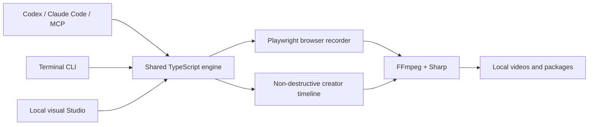

<p align="center">
  
</p>

<p align="center">
  <a href="https://github.com/khajaaijaz26/agent-demo-studio/actions/workflows/ci.yml"></a>
  <a href="LICENSE"></a>
  <a href="package.json"></a>
  <a href="https://github.com/khajaaijaz26/agent-demo-studio/releases"></a>
</p>

<p align="center">
  <strong>Let Codex, Claude Code, or any MCP client record a real browser, then turn the footage into polished product demos, YouTube videos, Shorts, Reels, TikToks, tutorials, and social variants—all locally.</strong>
</p>

Agent Demo Studio is an open-source MCP server, CLI, browser recorder, FFmpeg editing engine, and visual Studio. The same non-destructive project can produce landscape, vertical, square, portrait, and 4K exports with synchronized audio, captions, transitions, overlays, thumbnails, chapters, rights reports, and reviewed publishing packages.

<p align="center">
  
</p>

## What it can do

| Stage | Included capabilities |
|---|---|
| Record | Visible or headless Chromium, semantic click/fill/scroll/press/hover actions, live snapshots, chapters, click highlights, smooth cursor, scripted or adaptive agent control |
| Edit | Ordered clips, trims, image clips, constant speed, audio-synchronized stepped speed ramps, freeze frames, volume/mute, fit/fill/blur-background reframing, focus point, color/effect controls |
| Transition | Cut, fade, dissolve, directional wipe/slide/smooth, circle open/close, radial, and pixelize—with matching audio crossfades |
| Design | Brand palette, logo, text, lower thirds, calls to action, image overlays, watermarks, safe-zone-aware placement, thumbnails, classic cinematic browser frame |
| Audio | Clip audio, separate narration, music, looping, trims, delays, fades, gain, automatic music ducking, 48 kHz stereo, loudness normalization, limiting |
| Captions | SRT and WebVTT import, optional local Whisper transcription, scalable ASS burn-in, editable SRT sidecar, per-format safe zones |
| Automate | Silence detection, scene-change detection, suggested highlight ranges, eight editable templates, manifest validation, background jobs |
| Export | YouTube 1080p/4K, Shorts, Reels, TikTok, Stories, square, portrait, LinkedIn, and podcast-vertical presets |
| Deliver | MP4, thumbnail, captions, chapters, metadata, profile checks, asset-rights report, self-contained publishing package, explicit credentialed publishing adapters |

Everything runs on the creator's machine. No Agent Demo Studio account or hosted project storage is required.

## Quick start

Requirements: Node.js 20.12 or newer, FFmpeg/FFprobe on `PATH`, and Codex or Claude Code if you want agent control.

```bash
npm install --global github:khajaaijaz26/agent-demo-studio
agent-demo setup
agent-demo doctor
```

`agent-demo setup` installs Playwright Chromium when needed and registers the local MCP server with detected Codex and Claude Code installations. For another MCP client, run `agent-demo mcp-config` and use the printed configuration.

Create a browser demo immediately:

```bash
agent-demo quick https://example.com --title "A faster product tour"
```

Or open the all-in-one local Studio:

```bash
agent-demo studio
```

The Studio binds to `127.0.0.1` and opens in the default browser.

## Give the work to an AI agent

After setup, this is enough for Codex or Claude Code:

```text
Create a complete product demo for https://my-product.example.
Use a visible browser, show sign-in and the main workflow, add chapters,
then render a 1080p master plus Shorts, Reels, and TikTok variants.
Use natural narration, readable captions, quiet background music, and
return the local output files. Do not publish anything externally.
```

For an adaptive recording, the agent can inspect each browser snapshot and decide the next semantic action. For a known flow, it can submit the complete action list in one job. Media remains outside model context; MCP returns local file resources.

## Turn any recording into social variants

The fastest creator workflow needs only one source video:

```bash
agent-demo creator remix ./recording.mp4 \
  --presets youtube-1080p,shorts,reels,tiktok,square \
  --captions ./captions.srt \
  --music ./music.mp3 \
  --title "Launch day"
```

For a reusable timeline, start from one of the eight templates:

```bash
agent-demo creator templates
agent-demo creator init product-demo --source ./recording.mp4 --title "Product tour"
agent-demo creator validate creator-project.json
agent-demo creator render creator-project.json
```

Templates include `product-demo`, `feature-reel`, `launch-short`, `tutorial`, `talking-head`, `podcast-clip`, `testimonial`, and `before-after`.

The manifest stays editable JSON. A single project can hold clip timing, effects, captions, voice, music, brand design, licensing, metadata, and many export targets. See the [complete example](examples/creator-project.json) and [manifest reference](docs/CREATOR-MANIFEST.md).

```json
{
  "schemaVersion": 1,
  "title": "Feature launch",
  "clips": [
    {
      "id": "dashboard",
      "source": "./media/dashboard.mp4",
      "trimStartSeconds": 1.2,
      "trimEndSeconds": 8.4,
      "speedRamp": { "from": 1, "to": 1.6, "steps": 8 },
      "reframe": "blur-background",
      "transition": { "type": "slide-left", "durationSeconds": 0.35 }
    }
  ],
  "captions": { "source": "./captions.srt", "burn": true, "sidecar": true },
  "audio": {
    "music": { "source": "./music.mp3", "volume": 0.12, "loop": true },
    "duckMusic": true,
    "targetLufs": -14
  },
  "exports": [
    { "id": "youtube", "preset": "youtube-1080p" },
    { "id": "short", "preset": "shorts" },
    { "id": "reel", "preset": "reels" }
  ]
}
```

## Export profiles

| Preset | Canvas | Typical use |
|---|---:|---|
| `youtube-1080p` | 1920×1080 | Product demos, tutorials, courses |
| `youtube-4k` | 3840×2160 | High-detail masters |
| `shorts` | 1080×1920 | YouTube Shorts |
| `reels` | 1080×1920 | Instagram Reels |
| `tiktok` | 1080×1920 | TikTok posts |
| `story` | 1080×1920 | Mobile Stories |
| `square` | 1080×1080 | Cross-platform feed video |
| `portrait` | 1080×1350 | 4:5 feed video |
| `linkedin` | 1920×1080 | Professional product stories |
| `podcast-vertical` | 1080×1920 | Caption-led podcast excerpts |

Profiles define frame rate, bitrate, safe zones, and advisory limits. Rendered files are probed and validated against the selected profile. TikTok duration is checked against the authenticated creator's current API value during publishing rather than a stale hard-coded limit. See [platform profiles](docs/PLATFORM-PROFILES.md).

## Local analysis and captions

Detect silence, scene changes, and candidate highlights:

```bash
agent-demo creator analyze ./long-recording.mp4 --out analysis.json
```

Optional local transcription uses an installed Whisper CLI:

```bash
agent-demo creator transcribe ./long-recording.mp4 --model turbo --format srt
```

For scene-synchronized neural narration, install `edge-tts`, describe each recorded scene and voice in a synchronized manifest, then run `agent-demo sync tour.json`. Narration is generated scene by scene at a natural rate; the related visual timing is adjusted to match. Each configured voice receives its own master and optional SRT sidecar.

## Three control surfaces, one engine



- **MCP** gives agents structured recording, editing, analysis, rendering, packaging, and publishing tools.
- **CLI** makes every workflow scriptable in a terminal or CI environment.
- **Studio** provides project browsing, live preview, template/preset selection, a manifest editor, validation, analysis, background render progress, and output playback.

The architectural boundaries and render stages are documented in [docs/ARCHITECTURE.md](docs/ARCHITECTURE.md).

## MCP tools

| Group | Tools |
|---|---|
| Projects | `demo_create_project`, `demo_get_project`, `demo_list_projects` |
| Live browser | `demo_browser_start`, `demo_browser_snapshot`, `demo_browser_act`, `demo_browser_finish` |
| Product demos | `demo_record_flow`, `demo_generate_voice`, `demo_render`, `demo_render_synchronized` |
| Creator discovery | `demo_creator_presets`, `demo_creator_templates`, `demo_creator_validate` |
| Creator production | `demo_creator_render`, `demo_creator_remix`, `demo_creator_analyze`, `demo_creator_transcribe` |
| Delivery | `demo_creator_package`, `demo_creator_publish` |
| Operations | `demo_job_status`, `demo_open_studio`, `demo_doctor` |

Long recording and rendering work runs as background jobs. Agents poll `demo_job_status` and receive output resource links after completion.

## Browser recording scripts

Recordings can also be driven by portable JSON:

```json
{
  "title": "Analytics in action",
  "url": "http://localhost:3000",
  "actions": [
    { "type": "chapter", "label": "Create a report", "milliseconds": 900 },
    { "type": "click", "role": "button", "name": "Create report" },
    { "type": "fill", "selector": "#report-name", "value": "Q3 Growth Brief" },
    { "type": "click", "role": "button", "name": "Generate report" },
    { "type": "wait", "milliseconds": 1200 }
  ],
  "headless": false,
  "autoRender": true
}
```

```bash
agent-demo record demo.json
```

Supported actions: `navigate`, `click`, `fill`, `press`, `hover`, `scroll`, `wait`, and `chapter`. Accessible role/name locators are preferred, with CSS selector and visible-text fallbacks.

## Review packages and optional publishing

Create a self-contained folder for each rendered destination:

```bash
agent-demo creator package creator-project.json creator-output/creator-render-result.json
```

Each package contains the video, thumbnail, optional captions/chapters, metadata plan, profile result, and project-level asset-rights report.

YouTube, TikTok, and Instagram publishing adapters are included, but every external post requires an explicit `--confirm` plus account credentials supplied through environment variables. YouTube defaults to private. TikTok queries creator-specific privacy and duration options before upload. Instagram requires a public HTTPS video URL that Meta can fetch. No token is written to a project or package. See [publishing setup](docs/PUBLISHING.md).

## Privacy, security, and media rights

- Browser capture is deliberate and project-scoped; the basic recorder does not capture the entire desktop.
- Do not place passwords, session tokens, payment data, or customer secrets in a prompt or action script.
- Review every recording before sharing it externally.
- Source files are never overwritten; render intermediates are isolated and removed after the job.
- Every referenced media asset can carry license, attribution, creator, and proof metadata.
- Local generated ambient music is an original procedural asset; imported media remains the creator's responsibility.

Read [SECURITY.md](SECURITY.md), [the media-rights guide](docs/LICENSING.md), and [third-party notices](THIRD_PARTY_NOTICES.md).

## Install FFmpeg

```powershell
# Windows
winget install Gyan.FFmpeg
```

```bash
# macOS
brew install ffmpeg

# Ubuntu / Debian
sudo apt-get install ffmpeg
```

## Develop from source

```bash
git clone https://github.com/khajaaijaz26/agent-demo-studio.git
cd agent-demo-studio
npm install
npm run build
npm link
agent-demo setup
```

Verification commands:

```bash
npm run check          # typecheck, unit tests, build
npm run test:creator   # real FFmpeg creator render
npm run test:smoke     # real Chromium-to-H.264 product demo
```

CI runs the unit/build matrix on Windows and Linux plus separate real creator-engine and browser-to-video smoke jobs. Tagged releases produce an installable npm archive and GitHub release automatically.

## Project status and contribution

Version 0.2 is a local-first browser and creator production toolkit. It is not a cloud collaboration service or a full native-desktop capture system. The manifest, renderer, and provider boundaries are designed for extension without coupling agents to one hosted vendor.

Issues and pull requests are welcome. Start with [CONTRIBUTING.md](CONTRIBUTING.md), use the repository templates, and include a small fixture or screenshot for visible behavior changes.

## License

Agent Demo Studio is released under the [MIT License](LICENSE).
