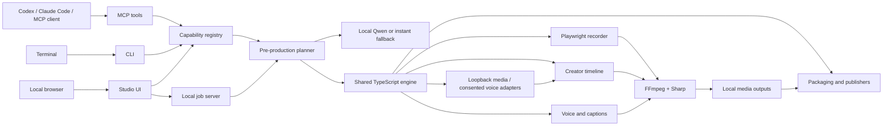

# Architecture

Agent Demo Studio is local-first and has one engine behind three control surfaces.

## Main boundaries

| Area | Location | Responsibility |
|---|---|---|
| Browser capture | `src/browser/recorder.ts` | Visible/headless Chromium sessions, semantic actions, raw screencast |
| Demo workflow | `src/workflow.ts` | Project creation, capture, voice, and classic polished demo render |
| Capability discovery | `src/capabilities.ts` | Request-aware inventory of local/free, configured, optional, networked, and unavailable production tools without generating media or exposing secrets |
| Pre-production | `src/creator/prompt.ts`, `local-ai.ts`, `assets.ts` | Fixed production rules, deterministic plan, optional one-call local Qwen refinement, resources/provenance, and plan-first creation |
| Open local generation | `src/creator/local-media.ts`, `comfyui.ts`, `ltx-desktop.ts`, `src/audio/voice-clone.ts` | Unrestricted prompt/reference handoff for installed text/image/video engines, exact scene-ID and motion QA, and consent-gated local voice profiles |
| Classic renderer | `src/render/` | Branded browser frame, design assets, synchronized scene narration |
| Creator contract | `src/creator/types.ts`, `schema.ts` | Portable timeline, validation, and versioning |
| Creator renderer | `src/creator/renderer.ts` | Clip normalization, speed, transitions, compositing, audio, exports |
| Automation | `src/creator/media.ts`, `captions.ts` | Probe, silence/scenes, highlights, SRT/VTT/ASS, optional Whisper |
| Delivery | `src/creator/social.ts`, `publish.ts` | Profile checks, packages, and explicit platform adapters |
| Control surfaces | `src/cli.ts`, `src/mcp/server.ts`, `src/studio/` | Equivalent terminal, agent, and visual workflows |

## Render stages

1. Inspect the selected planner, visuals, voice, music, caption, recording, and
   rendering capabilities without invoking generation.
2. Write requirements, creative direction, timed storyboard, resource/provenance
   list, capability gate, assumptions, workflow, and QA gates to
   `production-plan.json`. Stop here with setup guidance if a required selected
   capability is unavailable.
3. Resolve uploaded, supplied, bundled, generated, and optional resources. When
   configured, make one batch request to a loopback media adapter with the full
   prompt, character references, negative prompt, seed, language, audio, style,
   camera, and delivery context; then generate enabled narration, captions,
   score, ambience, or ASMR audio.
4. Build, parse, and semantically validate the editable schema-v2 manifest.
5. Resolve sources relative to the manifest or through stable `builtin:` URIs.
6. Probe streams, duration, frame rate, and audio availability.
7. Normalize each clip to the selected canvas, 48 kHz stereo, and a common frame rate.
8. Apply trim, stepped speed ramp, reframe, freeze, image motion, VFX, and clip gain.
9. Compose clips with 28 video transitions and matching audio transitions.
10. Rasterize timed design/character assets, composite animated image/video/chroma
   layers, and compile captions to ASS.
11. Mix clip audio, layered voices, music, ambience, and SFX with optional ducking.
12. Normalize/limit audio, encode MP4, and add fast-start metadata.
13. Extract a thumbnail, write captions/chapters, validate the result, and emit rights metadata.

Intermediate media lives under the selected output's `.work` directory and is removed after a successful or failed run unless `keepWork` is enabled. Source media is never overwritten.

## Extension rules

- Add a new delivery shape in `presets.ts`; do not fork the renderer.
- Add an editing operation to the creator schema and compile it in the segment or final-composite stage.
- Keep the plan as the contract between an ambiguous prompt and a concrete timeline; never silently discard its resource or QA requirements.
- Keep provider integrations optional and isolated from the local rendering path.
- Treat named modes as production treatments, never as a closed topic, style,
  scene, character, diagram, or voice vocabulary.
- Accept open uploaded/generated characters and scenes; bundled assets are starter
  resources, never a closed cast or mandatory style.
- Restrict local AI, media, and voice adapters to loopback endpoints. Require named
  authorization metadata before a cloned voice can enter the timeline.
- Never carry large media through model context; MCP returns local resource links.
- Preserve schema compatibility within a minor version or include an explicit migration.
